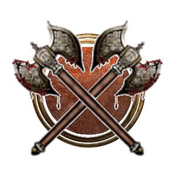

# Fury Barbarian

**Fury** is a modded Subclass of [[Barbarian]] that foregoes the defensive bonuses of [[Rage]] to instead gain more [[Rage Charges]] and new attacks to spend them on. Synergizes heavily with dual wielding.

> {{ get .loca "hf66e9153gca0eg4a51gba5bg7bc315652d59" | quote }}

## Subclass Features

### Level 3

![[Game/ControllerUIIcons/skills_png/Action_Barbarian_Frenzy.png]]

#### Rampage (Replaces Rage)

{{ getf .loca "haa4d01a9g591fg4694gb818g1ee27b2538cd" | include "wikify" }}

![[Game/ControllerUIIcons/skills_png/PassiveFeature_DualWielder_PassiveBonuses.png]]

#### Single-Minded Fury

When you make an offhand attack, you can add your Ability Score Modifier to the damage of the attack.

*Does not stack with Two Weapon Fighting if obtained from another source.*

#### Warrior Abilities: 2 Known

Choose 2 Warrior Abilities. Available options: [[Bloodthirst | Warrior---Abilities#Bloodthirst]], [[Raging Blow | Warrior---Abilities#Raging Blow]], [[Wild Strike | Warrior---Abilities#Wild Strike]], [[Execute | Warrior---Abilities#Execute]], [[Whirlwind | Warrior---Abilities#Whirlwind]], [[Charge | Warrior---Abilities#Charge]], and [[Thunder Clap | Warrior---Abilities#Thunder Clap]].

#### Talent: 1 Known

Choose 1 Warrior Talent. Available options: [[Meat Cleaver | Warrior---Talents#Meat Cleaver]], [[Double Time | Warrior---Talents#Double Time]], [[Sudden Death | Warrior---Talents#Sudden Death]], [[Fresh Meat | Warrior---Talents#Fresh Meat]], and [[Deep Wounds | Warrior---Talents#Deep Wounds]].

### Level 6

![[Game/ControllerUIIcons/skills_png/PassiveFeature_DualWielder_PassiveBonuses.png]]

#### Titan's Grip

You can use Two-Weapon Fighting even if your weapons aren't ?[[Light | Light (Weapon Property)]].

#### Warrior Abilities: 4 Known

Choose 2 additional Warrior Abilities. [[Storm Bolt | Warrior---Abilities#Storm Bolt]] is added to the available options.

#### Talents: 2 Known

Choose 1 additional Warrior Talent. Available options now also include [[Anger Management | Warrior---Talents#Anger Management]], [[Avatar | Warrior---Talents#Avatar]], [[Bladestorm | Warrior---Talents#Bladestorm]], and [[Recklessness | Warrior---Talents#Recklessness]].

### Level 10

#### Warrior Abilities: 6 Known

Choose 2 additional Warrior Abilities from the available Fury options on [[Warrior Abilities]].

#### Talents: 3 Known

Choose 1 additional Warrior Talent from the available Fury options on [[Warrior Talents]].
