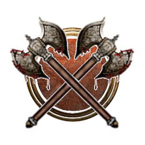

# Fury Barbarian

{{ if $.Values.FuryRevamp -}}
**Fury** is a modded Subclass of [[Barbarian]] that learns Warrior Abilities and enters its [[Rage]] with a Rampage attack. Synergizes heavily with dual wielding.
{{- else -}}
**Fury** is a modded Subclass of [[Barbarian]] that foregoes the defensive bonuses of [[Rage]] to instead gain more [[Rage Charges]] and new attacks to spend them on. Synergizes heavily with dual wielding.
{{- end }}

> {{ get .loca "hf66e9153gca0eg4a51gba5bg7bc315652d59" | quote }}

## Subclass Features

### Level 3

![[images/ControllerIcons/skills_png/Action_Warrior_Rampage.png]]

#### Rampage

*Replaces [[Rage]].*

{{ if $.Values.FuryRevamp -}}
- Costs 1 [[Bonus Action]] and 1 [[Rage Charge]]
- Weapon attack
- {{ get .loca "hbac4b9ceg8510g4730g85acg5d74220f4fa1" | include "wikify" }}
- {{ get .loca "h7da8ebe4gd911g47abg9df5gb6fdac217d80" | include "wikify" }}
{{- else -}}
{{ getf .loca "haa4d01a9g591fg4694gb818g1ee27b2538cd" | include "wikify" }}
{{- end }}

![[Game/ControllerUIIcons/skills_png/PassiveFeature_FightingStyle_TwoWeaponFighting.png]]

#### Single-Minded Fury

When you make an offhand attack, you can add your Ability Score Modifier to the damage of the attack.

*Does not stack with Two Weapon Fighting if obtained from another source.*

#### Warrior Abilities: {{ ternary 3 2 $.Values.FuryRevamp }} Known

Choose {{ ternary 3 2 $.Values.FuryRevamp }} Warrior Abilities from the options below.

- [[Bloodthirst | Warrior---Abilities#Bloodthirst]]
- [[Raging Blow | Warrior---Abilities#Raging Blow]]
- [[Wild Strike | Warrior---Abilities#Wild Strike]]
- [[Execute | Warrior---Abilities#Execute]]
- [[Whirlwind | Warrior---Abilities#Whirlwind]]
- [[Charge | Warrior---Abilities#Charge]]
- [[Thunder Clap | Warrior---Abilities#Thunder Clap]]
{{- if $.Values.FuryRevamp }}
- [[Ravager | Warrior---Abilities#Ravager]]
{{- end }}

#### Talent: 1 Known

Choose 1 Warrior Talent from the options below.

{{ if $.Values.FuryRevamp -}}
- [[Hack and Slash | Warrior---Talents#Hack and Slash]]
{{ end -}}
- [[Meat Cleaver | Warrior---Talents#Meat Cleaver]]
- [[Double Time | Warrior---Talents#Double Time]]
- [[Sudden Death | Warrior---Talents#Sudden Death]]
- [[Fresh Meat | Warrior---Talents#Fresh Meat]]
- [[Deep Wounds | Warrior---Talents#Deep Wounds]]

### Level 6

![[Game/ControllerUIIcons/skills_png/PassiveFeature_DualWielder_PassiveBonuses.png]]

#### Titan's Grip

You can use Two-Weapon Fighting even if your weapons aren't ?[[Light | Light (Weapon Property)]].

#### Warrior Abilities: {{ ternary 5 4 $.Values.FuryRevamp }} Known

Choose 2 additional Warrior Abilities. The following options are added to the available options:

- [[Recklessness | Warrior---Abilities#Recklessness]]
- [[Avatar | Warrior---Abilities#Avatar]]
- [[Bladestorm | Warrior---Abilities#Bladestorm]]
- [[Storm Bolt | Warrior---Abilities#Storm Bolt]]

#### Talents: 2 Known

Choose 1 additional Warrior Talent. The following options are added to the available options:

- [[Anger Management | Warrior---Talents#Anger Management]]
- [[Warbringer | Warrior---Talents#Warbringer]]

### Level 10

#### Warrior Abilities: {{ ternary 7 6 $.Values.FuryRevamp }} Known

Choose 2 additional Warrior Abilities from the available Fury options on [[Warrior Abilities]].

#### Talents: 3 Known

{{ if $.Values.FuryRevamp -}}
Choose 1 additional Warrior Talent. The following option is added to the available options:

- [[Unbridled Ferocity | Warrior---Talents#Unbridled Ferocity]]
{{- else -}}
Choose 1 additional Warrior Talent from the available Fury options on [[Warrior Talents]].
{{- end }}
