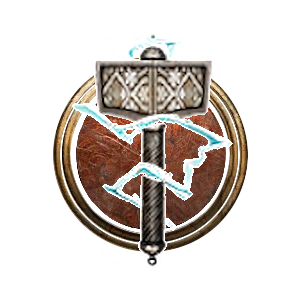

# Mountain Thane Barbarian

**Mountain Thane** is a modded Subclass of [[Barbarian]] that channels storm and earth while using Warrior Abilities.

> {{ get .loca "h5d99d766g2baeg4ab9gbaf5g869b06a144cb" | quote }}

## Subclass Features

### Level 3

![[Game/ControllerUIIcons/skills_png/Action_Monster_Duergar_DuergarEnlarge.png]]

#### Avatar (Replaces Rage)

{{ get .loca "h3f46a0c7g731eg4e20g8b8cg6bf31952ae0b" | include "wikify" }}

#### Warrior Abilities: 2 Known

Choose 2 Warrior Abilities from the options below.

- [[Bloodthirst | Warrior---Abilities#Bloodthirst]]
- [[Execute | Warrior---Abilities#Execute]]
- [[Whirlwind | Warrior---Abilities#Whirlwind]]
- [[Charge | Warrior---Abilities#Charge]]
- [[Thunder Clap | Warrior---Abilities#Thunder Clap]]

#### Talent: 1 Known

Choose 1 Warrior Talent from the options below.

- [[Thunder Blast | Warrior---Talents#Thunder Blast]]
- [[Double Time | Warrior---Talents#Double Time]]
- [[Sudden Death | Warrior---Talents#Sudden Death]]
- [[Fresh Meat | Warrior---Talents#Fresh Meat]]
- [[Deep Wounds | Warrior---Talents#Deep Wounds]]

### Level 6

#### Warrior Abilities: 4 Known

Choose 2 additional Warrior Abilities. The following options are added to the available options:

- [[Lightning Strike | Warrior---Abilities#Lightning Strike]]
- [[Storm Bolt | Warrior---Abilities#Storm Bolt]]

#### Talents: 2 Known

Choose 1 additional Warrior Talent. The following options are added to the available options:

- [[Storm Surge | Warrior---Talents#Storm Surge]]
- [[Anger Management | Warrior---Talents#Anger Management]]

### Level 10

#### Warrior Abilities: 6 Known

Choose 2 additional Warrior Abilities from the available Mountain Thane options on [[Warrior Abilities]].

#### Talents: 3 Known

Choose 1 additional Warrior Talent. The following option is added to the available options:

- [[Bolts of the Storm | Warrior---Talents#Bolts of the Storm]]
