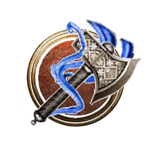

# Arms Fighter

**Arms** is a modded Subclass of [[Fighter]] that learns a broad selection of powerful weapon techniques. Each Warrior Ability has its own cooldown, allowing an Arms Fighter to rotate between several specialised attacks.

> {{ get .loca "hb64ef000ga75bg4ed9g86ddgd675d2bb2e2c" | quote }}

## Subclass Features

### Level 3

#### Warrior Abilities: 3 Known

Choose 3 Warrior Abilities. Available options: [[Charge | Warrior---Abilities#Charge]], [[Execute | Warrior---Abilities#Execute]], [[Whirlwind | Warrior---Abilities#Whirlwind]], [[Thunder Clap | Warrior---Abilities#Thunder Clap]], [[Overpower | Warrior---Abilities#Overpower]], [[Sweeping Strikes | Warrior---Abilities#Sweeping Strikes]], [[Cleave | Warrior---Abilities#Cleave]], and [[Mortal Strike | Warrior---Abilities#Mortal Strike]].

#### Talent: 1 Known

Choose 1 Warrior Talent. Available options: [[Double Time | Warrior---Talents#Double Time]], [[Sudden Death | Warrior---Talents#Sudden Death]], [[Deep Wounds | Warrior---Talents#Deep Wounds]], and [[Tactician | Warrior---Talents#Tactician]].

### Level 5

#### Warrior Abilities: 4 Known

Choose 1 additional Warrior Ability. [[Slam | Warrior---Abilities#Slam]] is added to the available options.

### Level 7

#### Warrior Abilities: 5 Known

Choose 1 additional Warrior Ability. [[Storm Bolt | Warrior---Abilities#Storm Bolt]] and [[Colossus Smash | Warrior---Abilities#Colossus Smash]] are added to the available options.

#### Talents: 2 Known

Choose 1 additional Warrior Talent. Available options now also include [[Anger Management | Warrior---Talents#Anger Management]], [[Avatar | Warrior---Talents#Avatar]], and [[Bladestorm | Warrior---Talents#Bladestorm]].

### Level 9

#### Warrior Abilities: 6 Known

Choose 1 additional Warrior Ability from the available Arms options on [[Warrior Abilities]].

### Level 10

#### Talents: 3 Known

Choose 1 additional Warrior Talent from the available Arms options on [[Warrior Talents]].

### Level 11

#### Warrior Abilities: 7 Known

Choose 1 additional Warrior Ability from the available Arms options on [[Warrior Abilities]].
