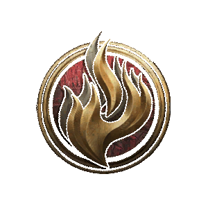

# Standard Magic Sorcerer

**Standard Magic** is a modded [[Sorcerer]] Subclass that turns the unpredictable effects of [[Wild Magic]] into a collection of spells you can learn and cast deliberately.

> {{ get .loca "hcd3bd1d9g7a86g4ffbg9fa6gd08747ed217f" | quote }}

Starting at Sorcerer Level 1, you learn one Standard Magic spell each Sorcerer level.

Standard Magic spells cost [[Sorcery Points]] and do not expend [[Spell Slots]]. None of them require [[Concentration]].

## Subclass Features

Standard Magic Sorcerers gain a passive at level 1 that gets improved / replaced as they level up.

### Level 1

![[Game/ControllerUIIcons/skills_png/PassiveFeature_WildMagicSurge.png]]

#### {{ get .loca "h5b77af38g0edcg446dga25bg5045d8599f01" }}

{{ get .loca "hdba7f743g9537g4204gb70fgeb40a98c1e90" | include "wikify" }}

### Level 2

![[Game/ControllerUIIcons/skills_png/PassiveFeature_WildMagicSurge.png]]

#### {{ get .loca "h015e025ag37e1g4762ga93agc79499586592" }}

{{ getf .loca "hd9ef2d7eg3e4bg4456gb82eg184c639e9a32" "1" | include "wikify" }}

### Level 6

![[Game/ControllerUIIcons/skills_png/PassiveFeature_WildMagicSurge.png]]

#### {{ get .loca "h0df6cd78g0340g4d57g834aga205b2007f73" }}

{{ getf .loca "ha74f2b3bgdcc4g49f0g894cg3fe8e33e098c" "2" | include "wikify" }}

### Level 11

![[Game/ControllerUIIcons/skills_png/PassiveFeature_WildMagicSurge.png]]

#### {{ get .loca "h26746129g2724g4e89g8b33g59299ec80f55" }}

{{ getf .loca "ha74f2b3bgdcc4g49f0g894cg3fe8e33e098c" "3" | include "wikify" }}

## Standard Magic Spells

Choose from the following spells as you gain Sorcerer levels. Saving Throws against these spells use your [[Spell Save DC]].

![[Game/ControllerUIIcons/skills_png/Action_WildMagic_GasCloud.png]]

### Standard Magic: Fog

- Available at Level 1
- Costs 1 [[Action]] and 1 [[Sorcery Point]]
- 18m range, 6m radius, 3-turn duration
- {{ get .loca "ha5c8bbcfg789bg48e8gb74bg2c1a5490815e" | include "wikify" }}

![[images/ControllerIcons/skills_png/Action_StandardMagic_Entangle.png]]

### Standard Magic: Entangle

- Available at Level 1
- Costs 1 [[Action]] and 1 [[Sorcery Point]]
- 18m range, 4m radius, 3-turn duration
- {{ get .loca "h2bca5541g977bg4d92ga123g5a3984025e71" | include "wikify" }}

![[images/ControllerIcons/skills_png/Action_StandardMagic_SpeakWithAnimals.png]]

### Standard Magic: Speak with Animals

- Available at Level 1
- Costs 1 [[Action]] and 1 [[Sorcery Point]] in combat
- {{ get .loca "h9048341dgad46g438egbe68g0ba148afbc3e" | include "wikify" }}
- Outside combat, this is a [[Ritual]] and does not expend Sorcery Points.

![[images/ControllerIcons/skills_png/Action_StandardMagic_Shield.png]]

### Standard Magic: Shield

- Available at Level 1
- Costs 1 [[Reaction]] and 1 [[Sorcery Point]]
- Lasts until the start of your next turn
- {{ get .loca "h75dacf68gdf75g498fg8e8dge0e9085685cf" | include "wikify" }}

![[Game/ControllerUIIcons/skills_png/Action_WildMagic_Burning.png]]

### Standard Magic: Burning

- Available at Level 3
- Costs 1 [[Action]] and 2 [[Sorcery Points]]
- 18m range, 6m radius
- Dexterity [[Saving Throw]], 5-turn duration
- {{ getf .loca "hc77cd053g34ceg41aag93f5ga3fa97bb3b72" "1d6 Fire Damage" "6m" "1d6 Fire Damage" | include "wikify" }}

![[Game/ControllerUIIcons/skills_png/Action_WildMagic_Teleport.png]]

### Standard Magic: Teleport

- Available at Level 3
- Costs 1 [[Bonus Action]] and 2 [[Sorcery Points]]
- {{ getf .loca "h0a34d5dag8e11g43b6g8551g5cd78b90aa3c" "9m" "2" | include "wikify" }}

![[Game/ControllerUIIcons/skills_png/Action_WildMagic_Blur.png]]

### Standard Magic: Blur

- Available at Level 3
- Costs 1 [[Action]] and 2 [[Sorcery Points]]
- 1.5m range, 3-turn duration
- {{ get .loca "h4947fdadg784bg45f0ga551gddc3fef219a8" | include "wikify" }}
- {{ get .loca "hf349df17ge3b5g4f81g8eabg01a8f1d8b40d" | include "wikify" }}

![[Game/ControllerUIIcons/skills_png/Action_WildMagic_Swap.png]]

### Standard Magic: Swap

- Available at Level 3
- Costs 1 [[Bonus Action]] and 2 [[Sorcery Points]]
- 9m range, Charisma [[Saving Throw]]
- {{ get .loca "h17f57044gd3a2g48e5g8fb9g8046b1305c38" | include "wikify" }}
- Grounded creatures cannot be targeted.

![[images/ControllerIcons/skills_png/Action_StandardMagic_SpikeGrowth.png]]

### Standard Magic: Spike Growth

- Available at Level 3
- Costs 1 [[Action]] and 2 [[Sorcery Points]]
- 18m range, 4m radius, 3-turn duration
- {{ getf .loca "h955d2ba9g16cdg404fg9395gc7d35678e7f0" "2d4 Piercing Damage" "1.5m" | include "wikify" }}

![[images/ControllerIcons/skills_png/Action_StandardMagic_EnlargeReduce.png]]

### Standard Magic: Enlarge or Reduce

- Available at Level 3
- Costs 1 [[Action]] and 2 [[Sorcery Points]]
- 9m range, 3-turn duration
- {{ get .loca "ha4d7dafag8092g4156g82d9gd0a6f0d835a5" | include "wikify" }}
- Allies are affected automatically; other creatures make a Constitution [[Saving Throw]].

#### Enlarge

{{ getf .loca "hc240c6acg3de8g42f7g9eb3g088cd90ecf1b" "1d4" | include "wikify" }}

#### Reduce

{{ getf .loca "hff4eb999gf26eg445ag9492g1811bcee6bf4" "1d4" | include "wikify" }}

![[Game/ControllerUIIcons/skills_png/Action_WildMagic_Heal.png]]

### Standard Magic: Heal

- Available at Level 5
- Costs 1 [[Bonus Action]] and 3 [[Sorcery Points]]
- Self, 5-turn duration
- {{ getf .loca "h4c615cbbgd2f2g4784g8a24g248015aa3bb9" "3m" "1d4 hit points" | include "wikify" }}

![[Game/ControllerUIIcons/skills_png/Action_WildMagic_Enchant.png]]

### Standard Magic: Enchant Weapon

- Available at Level 5
- Costs 1 [[Action]] and 3 [[Sorcery Points]]
- 1.5m range
{{ if $.Values.StandardMagicCriticalEnchantment -}}
- {{ get .loca "h021bb765g1c87g4338g9d4dgf5a56d9a60b0" | include "wikify" }}

#### Critical Enchantment

{{ getf .loca "h21816a2cgb738g4170gaddagfd9b6d1d2048" "1d4 Force Damage" | include "wikify" }}

#### Lasting Enchantment

{{ getf .loca "hc7cd3716gf1f5g4b33g8cd9g957ac6999ca5" "1d4 Force Damage" "1" | include "wikify" }}
{{ else -}}
- {{ getf .loca "hc7cd3716gf1f5g4b33g8cd9g957ac6999ca5" "1d4 Force Damage" "1" | include "wikify" }}
{{ end }}

![[Game/ControllerUIIcons/skills_png/Action_WildMagic_Mephit.png]]

### Standard Magic: Summon Mephit

- Available at Level 5
- Costs 1 [[Action]] and 3 [[Sorcery Points]]
- 18m range
- {{ get .loca "h9655ed84g3e01g4e07gb3a4g0d41cbc5dee5" | include "wikify" }}
- You control the Mephit. You can have one Standard Magic Mephit at a time.

![[images/ControllerIcons/skills_png/Action_StandardMagic_Fly.png]]

### Standard Magic: Fly

- Available at Level 5
- Costs 1 [[Bonus Action]] and 3 [[Sorcery Points]]
- 1.5m range, 2-turn duration
- {{ get .loca "hf13bcec1g58e0g4079g9d48g01f7c664db7e" | include "wikify" }}

![[images/ControllerIcons/skills_png/Action_StandardMagic_Slow.png]]

### Standard Magic: Slow

- Available at Level 5
- Costs 1 [[Action]] and 3 [[Sorcery Points]]
- Targets up to 6 non-allied creatures within 18m
- Wisdom [[Saving Throw]], 2-turn duration
- {{ get .loca "h87e09423gaa01g4372g99d2g7ff4d657e8d1" | include "wikify" }}

![[images/ControllerIcons/skills_png/Action_StandardMagic_ActionSurge.png]]

### Standard Magic: Action Surge

- Available at Level 7
- Costs 4 [[Sorcery Points]]
- Self, 1-turn duration, Usable Once per Short Rest
- {{ get .loca "h0ef20d23g3616g4c1cg8300gb41624ac5de7" | include "wikify" }}

![[images/ControllerIcons/skills_png/Action_StandardMagic_Polymorph.png]]

### Standard Magic: Polymorph

- Available at Level 7
- Costs 1 [[Action]] and 4 [[Sorcery Points]]
- 18m range, 2-turn duration
- {{ get .loca "h6500610dg265ag40a0ga2a3g763673b4cfb8" | include "wikify" }}
- Allies are affected automatically; other creatures make a Wisdom [[Saving Throw]].
- {{ get .loca "h525f4d5fgf9a7g441eg9132g2c14954a0137" | include "wikify" }}

![[images/ControllerIcons/skills_png/Action_StandardMagic_ResilientSphere.png]]

### Standard Magic: Resilient Sphere

- Available at Level 7
- Costs 1 [[Action]] and 4 [[Sorcery Points]]
- 9m range, 2-turn duration
- {{ get .loca "h92e01dabg5f34g4fc0gb458gab3f3443883e" | include "wikify" }}
- {{ get .loca "h5c073d04gd175g4757g8d47gc0a750e14552" | include "wikify" }}
- Allies are affected automatically; other creatures make a Dexterity [[Saving Throw]].

![[images/ControllerIcons/skills_png/Action_StandardMagic_Telekinesis.png]]

### Standard Magic: Telekinesis

- Available at Level 9
- Costs 1 [[Action]] and 5 [[Sorcery Points]]
- 18m range, Strength [[Saving Throw]], 2-turn duration
- {{ getf .loca "h06e72458gc0d2g4773g8ef2g2f0411182e2d" "18m" "2" | include "wikify" }}

![[images/ControllerIcons/skills_png/Action_StandardMagic_Cambion.png]]

### Standard Magic: Summon Cambion

- Available at Level 11
- Costs 1 [[Action]] and 6 [[Sorcery Points]]
- 18m range
- {{ get .loca "h047a7a3dg3371g489dg8a48g3d63f5dc8e6c" | include "wikify" }}
- Shares the summon limit with ?[[Planar Ally]]

![[Game/ControllerUIIcons/skills_png/Action_WildMagic_SorceryPoints.png]]

### Standard Magic: Sorcery Points

- Available at Level 11
- Costs 1 [[Action]] and 6 [[Sorcery Points]]
- Self, Usable Once per Long Rest
- {{ get .loca "hfdac2826g7f44g4e2ag84f3g02bba35aa794" | include "wikify" }}
