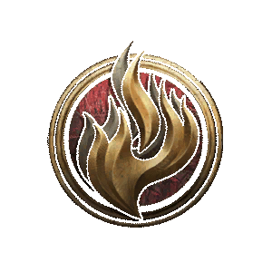

# Standard Magic Sorcerer

**Standard Magic** is a modded [[Sorcerer]] Subclass that turns the unpredictable effects of [[Wild Magic]] into a collection of spells you can learn and cast deliberately.

> {{ get .loca "hcd3bd1d9g7a86g4ffbg9fa6gd08747ed217f" | quote }}

Starting at Sorcerer Level 1, you learn one Standard Magic spell at every Sorcerer level. From Level 2 onward, you can also replace one Standard Magic spell you already know whenever you level up.

Standard Magic spells cost [[Sorcery Points]] and do not expend [[Spell Slots]]. None of them require [[Concentration]].

## Subclass Features

### Level 1

![[Game/ControllerUIIcons/skills_png/PassiveFeature_WildMagicSurge.png]]

#### Standard Magic

- Gain 1 [[Sorcery Point]] to use at Level 1.
- At Level 2, this is replaced by the ability to regain 1 Sorcery Point after a [[Short Rest]]. Your maximum Sorcery Points follows the normal Sorcerer progression.

The following Standard Magic spells become available:

- [[Standard Magic: Fog]]
- [[Standard Magic: Entangle]]
- [[Standard Magic: Speak with Animals]]
- [[Standard Magic: Shield]]

### Level 3

The following Standard Magic spells become available:

- [[Standard Magic: Burning]]
- [[Standard Magic: Teleport]]
- [[Standard Magic: Enchant Weapon]]
- [[Standard Magic: Blur]]
- [[Standard Magic: Swap]]
- [[Standard Magic: Spike Growth]]
- [[Standard Magic: Enlarge or Reduce]]

### Level 5

The following Standard Magic spells become available:

- [[Standard Magic: Heal]]
- [[Standard Magic: Summon Mephit]]
- [[Standard Magic: Fly]]
- [[Standard Magic: Slow]]

### Level 7

The following Standard Magic spells become available:

- [[Standard Magic: Action Surge]]
- [[Standard Magic: Polymorph]]
- [[Standard Magic: Resilient Sphere]]

### Level 9

- [[Standard Magic: Telekinesis]]
- [[Standard Magic: Summon Cambion]]

## Standard Magic Spells

The spells below are grouped and ordered by when they enter the selection pool. A harmful effect that permits a [[Saving Throw]] uses your [[Spell Save DC]].

### Available at Level 1

![[Game/ControllerUIIcons/skills_png/Action_WildMagic_GasCloud.png]]

### Standard Magic: Fog

- Costs 1 [[Action]] and 1 [[Sorcery Point]]
- 18m range, 6m radius, 3-turn duration
- The cloud Blinds and Heavily Obscures creatures within it.

![[images/ControllerIcons/skills_png/Action_StandardMagic_Entangle.png]]

### Standard Magic: Entangle

- Costs 1 [[Action]] and 1 [[Sorcery Point]]
- 18m range, 4m radius, 3-turn duration
- Creates a vine surface that slows creatures and can Entangle them.

![[images/ControllerIcons/skills_png/Action_StandardMagic_SpeakWithAnimals.png]]

### Standard Magic: Speak with Animals

- Costs 1 [[Action]] and 1 [[Sorcery Point]] in combat
- Lasts until [[Long Rest]]
- {{ get .loca "h9048341dgad46g438egbe68g0ba148afbc3e" | include "wikify" }}
- Outside combat, this is a [[Ritual]] and does not expend Sorcery Points.

![[images/ControllerIcons/skills_png/Action_StandardMagic_Shield.png]]

### Standard Magic: Shield

- Costs 1 [[Reaction]] and 1 [[Sorcery Point]]
- Lasts until the start of your next turn
- When you are about to be hit, increases your [[Armour Class]] by 5 and prevents all damage from [[Magic Missile]].

### Available at Level 3

![[Game/ControllerUIIcons/skills_png/Action_WildMagic_Burning.png]]

### Standard Magic: Burning

- Costs 1 [[Action]] and 2 [[Sorcery Points]]
- 18m range, 6m radius
- Dexterity [[Saving Throw]], 5-turn duration
- {{ getf .loca "hc77cd053g34ceg41aag93f5ga3fa97bb3b72" "6m" "1d6 Fire Damage" | include "wikify" }}

![[Game/ControllerUIIcons/skills_png/Action_WildMagic_Teleport.png]]

### Standard Magic: Teleport

- Costs 1 [[Bonus Action]] and 2 [[Sorcery Points]]
- {{ getf .loca "h0a34d5dag8e11g43b6g8551g5cd78b90aa3c" "9m" | include "wikify" }}
- The additional teleport does not cost Sorcery Points.

![[Game/ControllerUIIcons/skills_png/Action_WildMagic_Enchant.png]]

### Standard Magic: Enchant Weapon

- Costs 1 [[Action]] and 2 [[Sorcery Points]]
- 1.5m range
- {{ get .loca "h021bb765g1c87g4338g9d4dgf5a56d9a60b0" | include "wikify" }}

#### Critical Enchantment

{{ getf .loca "h21816a2cgb738g4170gaddagfd9b6d1d2048" "1d4 Force Damage" | include "wikify" }}

#### Lasting Enchantment

{{ getf .loca "hc7cd3716gf1f5g4b33g8cd9g957ac6999ca5" "1d4 Force Damage" | include "wikify" }}

![[Game/ControllerUIIcons/skills_png/Action_WildMagic_Blur.png]]

### Standard Magic: Blur

- Costs 1 [[Action]] and 2 [[Sorcery Points]]
- 1.5m range, 3-turn duration
- Target a creature. Attackers have [[Disadvantage]] on [[Attack Rolls]] against it.
- Does not affect creatures that do not rely on sight or that can see through illusions.

![[Game/ControllerUIIcons/skills_png/Action_WildMagic_Swap.png]]

### Standard Magic: Swap

- Costs 1 [[Bonus Action]] and 2 [[Sorcery Points]]
- 9m range, Charisma [[Saving Throw]]
- {{ get .loca "h17f57044gd3a2g48e5g8fb9g8046b1305c38" | include "wikify" }}
- Grounded creatures cannot be targeted.

![[images/ControllerIcons/skills_png/Action_StandardMagic_SpikeGrowth.png]]

### Standard Magic: Spike Growth

- Costs 1 [[Action]] and 2 [[Sorcery Points]]
- 18m range, 4m radius, 3-turn duration
- Movement through the spikes is halved. A creature walking on them takes 2d4 [[Piercing Damage]] for every 1.5m it moves.

![[images/ControllerIcons/skills_png/Action_StandardMagic_EnlargeReduce.png]]

### Standard Magic: Enlarge or Reduce

- Costs 1 [[Action]] and 2 [[Sorcery Points]]
- 9m range, 3-turn duration
- Make a creature larger or smaller, changing its weapon damage and Strength Checks and Saving Throws.
- Willing targets are affected automatically. Unwilling targets make a Constitution [[Saving Throw]].

#### Enlarge

The target's weapon and unarmed attacks deal an additional 1d4 damage. It gains [[Advantage]] on Strength Checks and Saving Throws.

#### Reduce

The target's weapons deal 1d4 less damage. It gains [[Disadvantage]] on Strength Checks and Saving Throws.

### Available at Level 5

![[Game/ControllerUIIcons/skills_png/Action_WildMagic_Heal.png]]

### Standard Magic: Heal

- Costs 1 [[Bonus Action]] and 3 [[Sorcery Points]]
- Self, 5-turn duration
- {{ getf .loca "h4c615cbbgd2f2g4784g8a24g248015aa3bb9" "3m" "1d4 hit points" | include "wikify" }}

![[Game/ControllerUIIcons/skills_png/Action_WildMagic_Mephit.png]]

### Standard Magic: Summon Mephit

- Costs 1 [[Action]] and 3 [[Sorcery Points]]
- 18m range
- {{ get .loca "h9655ed84g3e01g4e07gb3a4g0d41cbc5dee5" | include "wikify" }}
- Choose a controlled Mud Mephit or Magma Mephit. You can have one Standard Magic Mephit at a time.

![[images/ControllerIcons/skills_png/Action_StandardMagic_Fly.png]]

### Standard Magic: Fly

- Costs 1 [[Bonus Action]] and 3 [[Sorcery Points]]
- 1.5m range, 2-turn duration
- Bestows the ability to Fly upon yourself or an ally.

![[images/ControllerIcons/skills_png/Action_StandardMagic_Slow.png]]

### Standard Magic: Slow

- Costs 1 [[Action]] and 3 [[Sorcery Points]]
- Targets up to 6 hostile creatures within 18m
- Wisdom [[Saving Throw]], 2-turn duration
- Slowed creatures have reduced movement and actions, and take a -2 penalty to [[Armour Class]] and Dexterity Saving Throws.

### Available at Level 7

![[images/ControllerIcons/skills_png/Action_StandardMagic_ActionSurge.png]]

### Standard Magic: Action Surge

- Costs 4 [[Sorcery Points]] and no action
- Self, 1-turn duration
- Immediately gain an extra Action to use this turn.

![[images/ControllerIcons/skills_png/Action_StandardMagic_Polymorph.png]]

### Standard Magic: Polymorph

- Costs 1 [[Action]] and 4 [[Sorcery Points]]
- 18m range, 2-turn duration
- {{ get .loca "h6500610dg265ag40a0ga2a3g763673b4cfb8" | include "wikify" }}
- Choose Sheep, Cat, or Dog directly. Willing targets are affected automatically; unwilling targets make a Wisdom [[Saving Throw]].

![[images/ControllerIcons/skills_png/Action_StandardMagic_CatsAndDogs.png]]

#### Cat or Dog

The Cat and Dog choices use the same cost, duration, and saving throw as Sheep.

![[images/ControllerIcons/skills_png/Action_StandardMagic_ResilientSphere.png]]

### Standard Magic: Resilient Sphere

- Costs 1 [[Action]] and 4 [[Sorcery Points]]
- 9m range, 2-turn duration
- Encloses the target in a sphere of shimmering force, blocking all incoming damage and spell effects.
- Willing targets are affected automatically. Unwilling targets make a Dexterity [[Saving Throw]].

### Available at Level 9

![[images/ControllerIcons/skills_png/Action_StandardMagic_Telekinesis.png]]

### Standard Magic: Telekinesis

- Costs 1 [[Action]] and 5 [[Sorcery Points]]
- Self, 2-turn duration
- {{ get .loca "h06e72458gc0d2g4773g8ef2g2f0411182e2d" | include "wikify" }}
- Moving a creature or object with the unlocked Telekinesis action costs an Action.

![[images/ControllerIcons/skills_png/Action_StandardMagic_Cambion.png]]

### Standard Magic: Summon Cambion

- Costs 1 [[Action]] and 5 [[Sorcery Points]]
- 18m range
- {{ get .loca "h047a7a3dg3371g489dg8a48g3d63f5dc8e6c" | include "wikify" }}
- The Cambion is controlled by the player. It uses the normal Planar Ally summon limit and a separate limit from Standard Magic Mephits.
